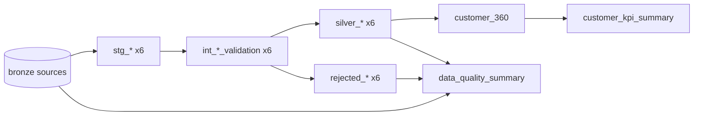

# Enterprise Customer 360 Lakehouse

An end-to-end lakehouse that unifies six operational sources (CRM, addresses, e-commerce orders, payment gateway, Zendesk-style support and a loyalty platform) into a single, tested **Customer 360** view, with a data quality layer that tracks every rejected record.

Built with **Databricks + Unity Catalog**, **dbt**, **PySpark** and **Power BI**, on ~1.3M synthetic records generated with **Faker** that deliberately include duplicates, nulls, bad emails, invalid statuses, negative amounts, future dates and orphaned foreign keys.

The whole pipeline also runs **locally** with one command (PySpark plus dbt on a local Spark session), so you can reproduce it without a Databricks workspace.

---

## Architecture

```mermaid
flowchart LR
    subgraph Sources["Synthetic sources (Faker)"]
        C[CRM customers]
        A[CRM addresses]
        O[E-commerce orders]
        P[Payment gateway]
        T[Support tickets]
        L[Loyalty accounts]
    end

    subgraph UC["Databricks · Unity Catalog (workspace)"]
        V[(Volume<br/>landing CSVs)]
        B[(bronze.*<br/>raw Delta tables)]
        S[(silver.*<br/>validated + rejected_*)]
        G[(gold.*<br/>customer_360 · KPIs · DQ)]
    end

    Sources --> V
    V -- "bronze_ingestion notebook<br/>(config-driven, parameterised)" --> B
    B -- "dbt: staging → intermediate → silver" --> S
    S -- "dbt: gold marts" --> G
    G --> PBI[Power BI<br/>enterprise360.pbix]
```



**Medallion layers**

| Layer | What happens | Where |
|---|---|---|
| Landing | Faker CSVs uploaded to a Unity Catalog Volume | `src/data_generator/` |
| Bronze | Raw data loaded as-is into Delta tables `workspace.bronze.*`; one generic notebook driven by `config/datasets.py` and a `dataset_name` widget | `databricks/bronze/bronze_ingestion.ipynb` |
| Staging | Type casting, trimming and case standardisation (views) | `dbt/.../models/staging/` |
| Intermediate | Deduplication on the primary key (latest `updated_at` wins), referential integrity checks and rule-based validation with a `rejection_reason` (ephemeral) | `dbt/.../models/intermediate/` |
| Silver | Valid records in `silver_*`, failures in `rejected_*` | `dbt/.../models/silver/` |
| Gold | `customer_360`, `customer_kpi_summary`, `data_quality_summary` | `dbt/.../models/gold/` |

The original PySpark implementation of every layer is kept in `src/` (local) and `databricks/silver`, `databricks/gold` (notebooks). dbt is now the source of truth for Silver and Gold on Databricks, and the local PySpark and dbt outputs reconcile exactly (same KPI and data quality numbers).

### dbt lineage



Validation order matters: orders, addresses, tickets and loyalty accounts are checked against `silver_customers`, and payments are checked against both `silver_customers` and `silver_orders`, so orphans are rejected rather than silently dropped by joins.

---

## Data model

**Sources** (generated with fixed seeds, 100k customers by default)

| Source | Key | Volume | Injected problems |
|---|---|---|---|
| `customers` | `customer_id` | 102,000 | 2% duplicates, invalid emails, null phone and DOB |
| `addresses` | `address_id` | 101,000 | duplicates, invalid states, null postcodes |
| `orders` | `order_id` | 484,628 | duplicates, invalid statuses, negative amounts, future dates, null customer |
| `payments` | `payment_id` | 446,598 | duplicates, orphan payments for missing orders, invalid statuses, negative amounts |
| `support_tickets` | `ticket_id` | 75,857 | duplicates, resolved before created, invalid statuses, null customer |
| `loyalty_accounts` | `loyalty_account_id` | 55,550 | duplicates, invalid tiers and statuses, negative points, future join dates |

**Gold: `customer_360`** has one row per valid customer:

| Group | Columns |
|---|---|
| Profile | `customer_id`, `first_name`, `last_name`, `email`, `gender`, `status`, `signup_date` |
| Primary address | `state`, `postcode`, `country` |
| Orders | `total_orders`, `total_revenue` (paid, shipped, delivered), `last_order_date` |
| Payments | `successful_payment_count`, `successful_payment_amount`, `last_payment_date` |
| Support | `support_ticket_count`, `open_ticket_count`, `last_support_ticket_date` |
| Loyalty | `loyalty_tier`, `points_balance`, `loyalty_status` |

**Gold: `customer_kpi_summary`** is a single row of business KPIs (active and blocked customers, revenue, loyalty reach, open tickets).

**Gold: `data_quality_summary`** has one row per source with Bronze rows, valid rows, rejected rows, duplicates removed and rejection rate.

### Data quality results (100k customer run)

| Source | Bronze rows | Silver valid | Rejected | Rejection rate |
|---|---:|---:|---:|---:|
| customers | 102,000 | 99,048 | 952 | 0.95% |
| addresses | 101,000 | 97,546 | 2,454 | 2.45% |
| orders | 484,628 | 469,825 | 10,005 | 2.09% |
| payments | 446,598 | 430,303 | 12,751 | 2.88% |
| support_tickets | 75,857 | 73,623 | 1,483 | 1.97% |
| loyalty_accounts | 55,550 | 53,720 | 1,280 | 2.33% |

Headline KPIs: 99,048 customers in the 360 view, 59,387 with orders, **$588.1M** recognised revenue, 53,720 loyalty members.

---

## Testing

- **dbt tests** (75): `not_null`, `unique`, `accepted_values` and `relationships` on every Silver model, plus Gold tests and singular tests that check `customer_360` has every Silver customer exactly once, the KPI table is a single row, and Silver never has more rows than Bronze.
- **pytest contract tests** (`tests/`): run every Faker generator and assert its output columns match the Bronze ingestion schema exactly, so a generator change can't silently shift columns.
- **CI** (`.github/workflows/ci.yml`): runs pytest, then the full local pipeline and `dbt build` on a 2,000 customer dataset for every push and pull request.

---

## Run it locally

Requirements: Python 3.10+, Java 17 (for Spark).

```bash
python -m venv .venv && source .venv/bin/activate
pip install -r requirements.txt

# Full pipeline: generate -> Bronze -> Silver -> Gold -> Power BI CSVs -> dbt build + tests
NUM_CUSTOMERS=2000 ./scripts/run_local_pipeline.sh

# Full-size dataset (100k customers, takes a while)
./scripts/run_local_pipeline.sh

# Contract tests
pytest tests
```

Outputs land in `data/` (Parquet, git-ignored) and `dashboards/powerbi_data/` (CSV for Power BI). The dbt run uses the `local` target in `dbt/customer_360/profiles.example.yml`, which runs dbt on an in-process Spark session against Bronze tables registered by `scripts/register_local_bronze.py`.

## Run it on Databricks

1. Generate the data locally (`python src/data_generator/generate_customers.py` and the other five generators) and upload the CSVs to the Volume `/Volumes/workspace/default/data/`.
2. Update the file names in `databricks/config/datasets.py` if they differ.
3. Run `databricks/bronze/bronze_ingestion.ipynb` once per dataset (widget `dataset_name` = `customers`, `addresses`, `orders`, `payments`, `support_tickets`, `loyalty_accounts`), or as a Databricks Job task looping over the six values. This creates `workspace.bronze.*`.
4. Run dbt against a SQL warehouse:

```bash
cd dbt/customer_360
cp profiles.example.yml profiles.yml
export DATABRICKS_HOST=... DATABRICKS_HTTP_PATH=... DATABRICKS_TOKEN=...
dbt build --profiles-dir . --target databricks
dbt docs generate --profiles-dir . && dbt docs serve
```

This builds `workspace.staging`, `workspace.silver` and `workspace.gold`. The Bronze catalog can be overridden with `--vars '{bronze_catalog: my_catalog}'`.

5. Open `dashboards/enterprise360.pbix` in Power BI Desktop (it reads the exported Gold CSVs).

---

## Repository layout

```
├── src/
│   ├── data_generator/   Faker generators for the six sources
│   ├── bronze/           Local PySpark Bronze ingestion with an ingestion log
│   ├── silver/           Local PySpark Silver jobs (validation + rejected records)
│   └── gold/             Local PySpark Gold jobs and Power BI export
├── databricks/
│   ├── config/           Dataset registry used by the Bronze notebook
│   ├── utilities/        Read and Delta write helpers
│   ├── bronze/           Generic, parameterised Bronze ingestion notebook
│   ├── silver/, gold/    Notebook versions of the PySpark jobs (superseded by dbt)
├── dbt/customer_360/     dbt project: staging, intermediate, silver, gold, tests
├── dashboards/           Power BI report and the Gold CSV extracts it reads
├── scripts/              One-command local run and local Bronze registration
└── tests/                pytest contract tests
```

## Tech stack

Databricks · Unity Catalog · Delta Lake · dbt (dbt-databricks, dbt-spark) · PySpark · Python · Faker · pandas · pytest · GitHub Actions · Power BI

## Author

Abhishek Teotia
