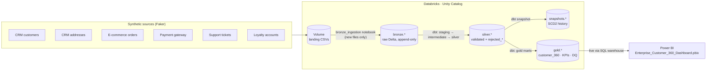
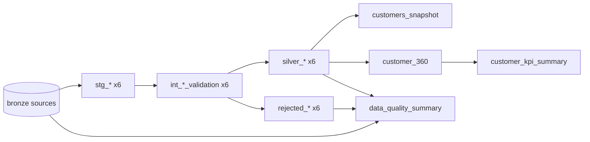
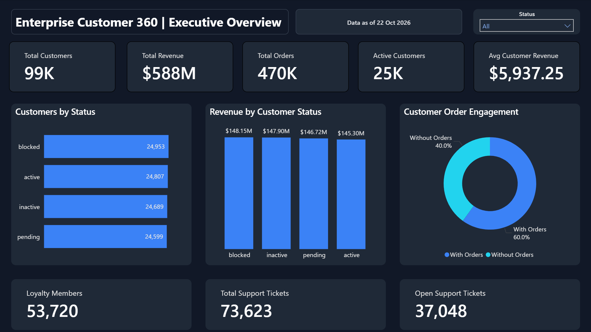
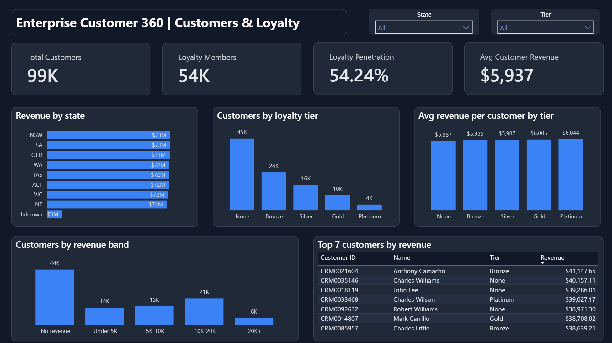
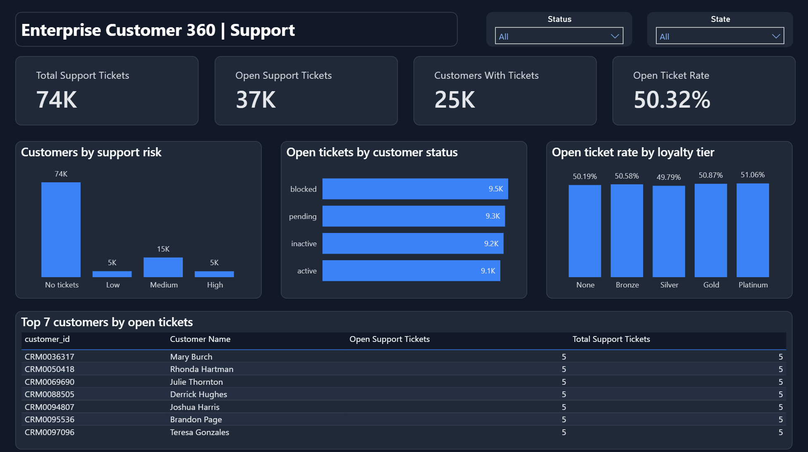
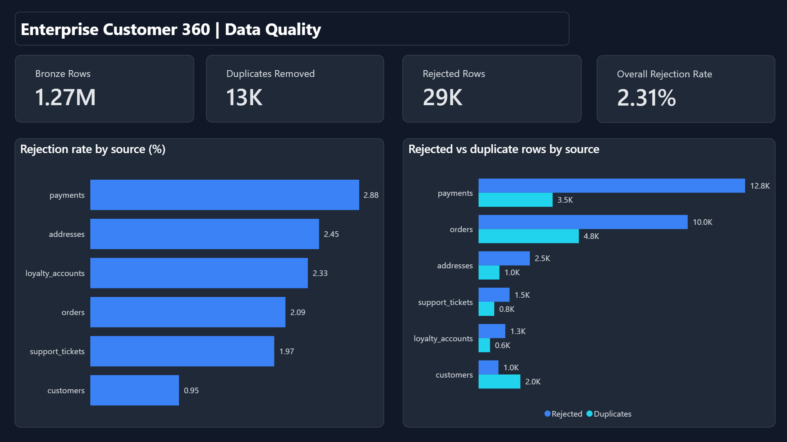

# Enterprise Customer 360 Lakehouse

An end-to-end lakehouse that unifies six operational sources (CRM, addresses, e-commerce orders, payment gateway, Zendesk-style support and a loyalty platform) into a single, tested **Customer 360** view, with a data quality layer that tracks every rejected record and a Power BI report on top.

Built with **Databricks + Unity Catalog**, **dbt**, **PySpark** and **Power BI**, on ~1.3M synthetic records generated with **Faker** that deliberately include duplicates, nulls, bad emails, invalid statuses, negative amounts, future dates and orphaned foreign keys.

It runs in production as a scheduled Databricks job deployed with **Databricks Asset Bundles**, with separate dev and prod targets, a service principal, failure alerts and data quality gates. The whole pipeline also runs **locally** with one command, so you can reproduce it without a Databricks workspace.

---

## Architecture



**Medallion layers**

| Layer | What happens | Where |
|---|---|---|
| Landing | Faker CSVs uploaded to a Unity Catalog Volume | `src/data_generator/` |
| Bronze | Raw data appended to Delta tables `bronze.*`. Only files not loaded before are read, tracked by `_source_file`, and every row gets `_ingestion_timestamp` | `databricks/bronze/bronze_ingestion.ipynb` |
| Staging | Type casting, trimming and case standardisation (views) | `dbt/.../models/staging/` |
| Intermediate | Deduplication on the primary key, referential integrity checks and rule-based validation with a `rejection_reason` (ephemeral) | `dbt/.../models/intermediate/` |
| Silver | Valid records in `silver_*`, failures in `rejected_*`. Orders and payments are incremental (Delta `MERGE`) | `dbt/.../models/silver/` |
| Snapshots | SCD Type 2 history of customers (`check` strategy on business columns) | `dbt/.../snapshots/` |
| Gold | `customer_360`, `customer_kpi_summary`, `data_quality_summary` | `dbt/.../models/gold/` |

### dbt lineage



Validation order matters: orders, addresses, tickets and loyalty accounts are checked against `silver_customers`, and payments are checked against both `silver_customers` and `silver_orders`, so orphans are rejected rather than silently dropped by joins.

---

## Production features

| Area | What's in place |
|---|---|
| Orchestration | One Databricks job, `customer_360_workflow`: a for-each task ingests the six sources in parallel, then a dbt task runs `dbt source freshness` and `dbt build`. Daily at 06:00 Australia/Sydney |
| Deployment as code | Databricks Asset Bundle (`databricks.yml`, `resources/`) with variables for warehouse, catalog and alert email |
| Environments | `dev` target (own `dev` catalog, `[dev]` job prefix, schedule paused) and `prod` target (`workspace` catalog, schedule live) |
| Identity and access | Prod runs as the `customer-360-runner` service principal with least-privilege Unity Catalog grants, kept as code in `databricks/setup/grants.sql` |
| Data quality gates | Source freshness (warn 24h, error 48h), 77 dbt tests, and rejection-rate thresholds (warn above 3%, fail above 5%) that stop the run before bad data reaches Gold |
| Alerting | Email on job failure |
| Incremental processing | Bronze reads only new files. `silver_orders` and `silver_payments` merge only rows loaded since the last run |
| History | SCD Type 2 snapshot of customers, so status changes are kept over time |
| Robust deduplication | Latest version wins, but future-dated source timestamps are ranked last and ties break on load time |
| Performance | Liquid clustering on `silver_orders`, `silver_payments` and `gold.customer_360` |
| CI | GitHub Actions runs contract tests and the full local pipeline plus `dbt build` on every push and pull request |

---

## Dashboard

A four-page Power BI report reads `workspace.gold` live from the Databricks SQL warehouse. Host, HTTP path and catalog are report parameters, so the same file can point at dev or prod.

**Executive Overview**: headline cards (customers, revenue, orders, active customers, average customer revenue, loyalty members, total and open support tickets), customers and revenue by status, and an order-engagement donut (customers with vs without orders). Status slicer and a "data as of" card from the Gold load time.



**Customers & Loyalty**: loyalty penetration (54.2%), revenue by state, customers and average revenue by tier, customers by revenue band, and the top 7 customers by revenue. State and tier slicers.



**Support**: ticket volume, open tickets and open-ticket rate, support-risk segments (High = 3+ open tickets, Medium = 1–2, Low = tickets but none open), open tickets by customer status and open-ticket rate by tier, plus the top 7 customers by open tickets. State and status slicers are synced across pages.



**Data Quality**: Bronze rows, valid and rejected rows, duplicates removed and rejection rate per source, straight from `data_quality_summary`. The overall rate is rejected rows over processed rows, not an average of the per-source rates.



---

## Findings

From the 100k-customer run.

**Data quality**

| Source | Bronze rows | Silver valid | Rejected | Rejection rate |
|---|---:|---:|---:|---:|
| customers | 102,000 | 99,048 | 952 | 0.95% |
| addresses | 101,000 | 97,546 | 2,454 | 2.45% |
| orders | 484,628 | 469,825 | 10,005 | 2.09% |
| payments | 446,598 | 430,303 | 12,751 | 2.88% |
| support_tickets | 75,857 | 73,623 | 1,483 | 1.97% |
| loyalty_accounts | 55,550 | 53,720 | 1,280 | 2.33% |

- Every source is under the 3% warning threshold. Payments is closest (2.88%), mainly from orphan payments that reference orders which don't exist.
- Deduplication removed 1–2% of rows per source (12.6K duplicates in total, most in orders and payments).
- While building the SCD2 snapshot, a real bug surfaced: source rows with a **future `updated_at`** always won deduplication, so a genuine later update was ignored. Deduplication now ranks future-dated rows last in every model.

**Business**

- **99,048** customers in the 360 view and **$588.1M** recognised revenue (paid, shipped and delivered orders).
- **40%** of valid customers have never placed an order. The 59,387 who have spend about **$9,900** each on average, and about 4,000 of them have orders but **$0** recognised revenue, because their orders are all placed, cancelled or returned.
- Revenue is concentrated: the **top 10%** of customers generate **36%** of revenue.
- **54%** of customers are loyalty members, but members spend only about 1.6% more than non-members ($5,980 vs $5,887). Tier has almost no effect on spend or on support outcomes.
- About **half of all support tickets are still open** (37,048 of 73,623), and the open-ticket rate is roughly 50% for every tier and status.
- **4,617 customers are high support risk** (3 or more open tickets).
- **5,100 blocked customers still have open tickets**, and blocked customers account for about a quarter of recognised revenue. In a real business this would be worth a follow-up with the support and risk teams.
- Successful payments total **$883M**, well above the $588M recognised revenue. Revenue only counts paid, shipped and delivered orders, while payments also include cancelled and returned orders and multiple payments per order. Reconciling payments to orders would be the next Gold model to build.

The data is synthetic and the generators draw most attributes independently, so segments come out close to uniform (each state and status is about 25% or 12.5% of revenue). The value of the project is the pipeline, quality controls and modelling, not the business numbers themselves.

---

## Testing

- **dbt tests** (77): `not_null`, `unique`, `accepted_values` and `relationships` on every Silver model, plus Gold tests and singular tests. They check that `customer_360` has every Silver customer exactly once, the KPI table is a single row, Silver never has more rows than Bronze, and rejection rates stay under the warn and error thresholds.
- **Source freshness**: `dbt source freshness` on `_ingestion_timestamp` for all six Bronze sources.
- **pytest contract tests** (`tests/`): run every Faker generator and assert its output columns match the Bronze ingestion schema exactly, so a generator change can't silently shift columns.
- **CI** (`.github/workflows/ci.yml`): runs pytest, then the full local pipeline and `dbt build` on a 2,000-customer dataset for every push and pull request.

---

## Run it locally

Requirements: Python 3.10+, Java 17 (for Spark).

```bash
python -m venv .venv && source .venv/bin/activate
pip install -r requirements.txt

# Full pipeline: generate -> Bronze -> Silver -> Gold -> Power BI CSVs -> dbt build + tests
NUM_CUSTOMERS=2000 ./scripts/run_local_pipeline.sh

# Full-size dataset (100k customers, takes a while)
./scripts/run_local_pipeline.sh

# Contract tests
pytest tests
```

Outputs land in `data/` (Parquet, git-ignored) and `dashboards/powerbi_data/` (CSV). The dbt run uses the `local` target in `dbt/customer_360/profiles.example.yml`, which runs dbt on an in-process Spark session against Bronze tables registered by `scripts/register_local_bronze.py`. Snapshots are skipped locally because the local Spark session has no Delta `MERGE`.

## Run it on Databricks

1. Generate the data locally (`python src/data_generator/generate_customers.py` and the other five generators) and upload the CSVs to the Volume `/Volumes/workspace/default/data/`. File names must match the patterns in `databricks/config/datasets.py` (for example `crm_customers_*.csv`). New files dropped later are picked up incrementally.
2. Create the dev catalog once: `CREATE CATALOG IF NOT EXISTS dev;`
3. For prod, create a service principal and apply `databricks/setup/grants.sql` (plus **Can use** on the SQL warehouse), then set its application ID in the `prod` target's `run_as`.
4. Deploy and run with the Databricks CLI:

```bash
export BUNDLE_VAR_alert_email="you@example.com"
databricks bundle validate -t dev
databricks bundle deploy -t dev     # dev catalog, schedule paused
databricks bundle run -t dev customer_360_workflow

databricks bundle deploy -t prod    # workspace catalog, runs daily at 06:00 Sydney
databricks bundle run -t prod customer_360_workflow
```

5. Open `dashboards/Enterprise_Customer_360_Dashboard.pbix` in Power BI Desktop. It reads `workspace.gold` straight from the Databricks SQL warehouse. Use **Transform data ▾ → Edit parameters** to point `DatabricksHost`, `HttpPath` and `Catalog` at your workspace.

To run dbt by hand against a SQL warehouse instead:

```bash
cd dbt/customer_360
cp profiles.example.yml profiles.yml
export DATABRICKS_HOST=... DATABRICKS_HTTP_PATH=... DATABRICKS_TOKEN=...
dbt build --profiles-dir . --target databricks
dbt docs generate --profiles-dir . && dbt docs serve
```

---

## Repository layout

```
├── databricks.yml        Asset Bundle: variables and dev/prod targets
├── resources/            Job definition (customer_360_workflow)
├── src/
│   ├── data_generator/   Faker generators for the six sources
│   ├── bronze/           Local PySpark Bronze ingestion with an ingestion log
│   ├── silver/           Local PySpark Silver jobs (validation + rejected records)
│   └── gold/             Local PySpark Gold jobs and Power BI export
├── databricks/
│   ├── config/           Dataset registry used by the Bronze notebook
│   ├── utilities/        File discovery, read and Delta write helpers
│   ├── bronze/           Generic, parameterised, incremental Bronze ingestion notebook
│   ├── setup/            Unity Catalog grants for the service principal
│   └── silver/, gold/    Notebook versions of the PySpark jobs (superseded by dbt)
├── dbt/customer_360/     dbt project: staging, intermediate, silver, gold, snapshots, tests
├── dashboards/           Power BI report (live on Databricks Gold), screenshots/ and Gold CSV extracts from the local run
├── scripts/              One-command local run and local Bronze registration
└── tests/                pytest contract tests
```

## Tech stack

Databricks · Unity Catalog · Delta Lake · Databricks Asset Bundles · dbt (dbt-databricks, dbt-spark) · PySpark · Python · Faker · pandas · pytest · GitHub Actions · Power BI

## Author

Abhishek Teotia
